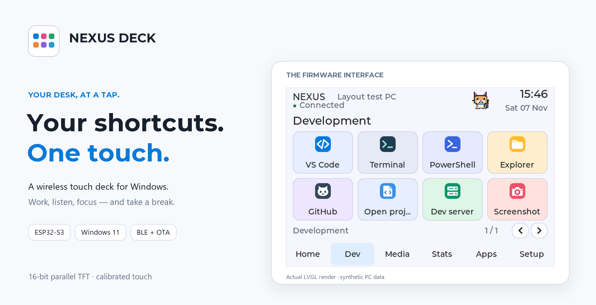
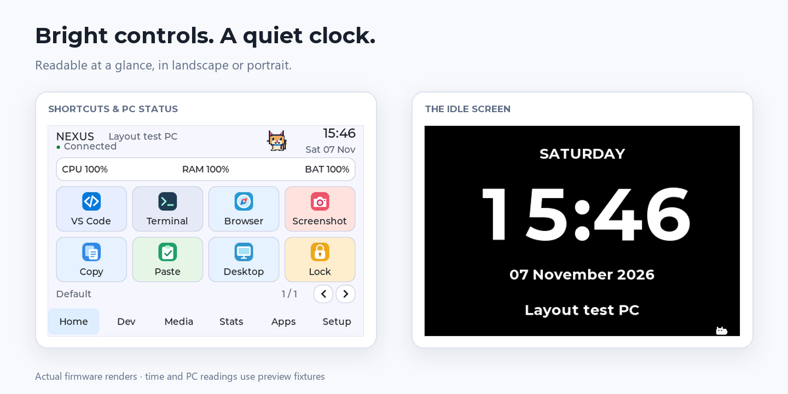
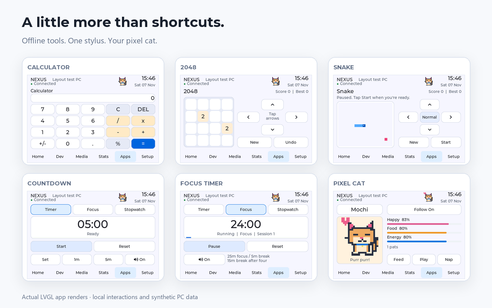
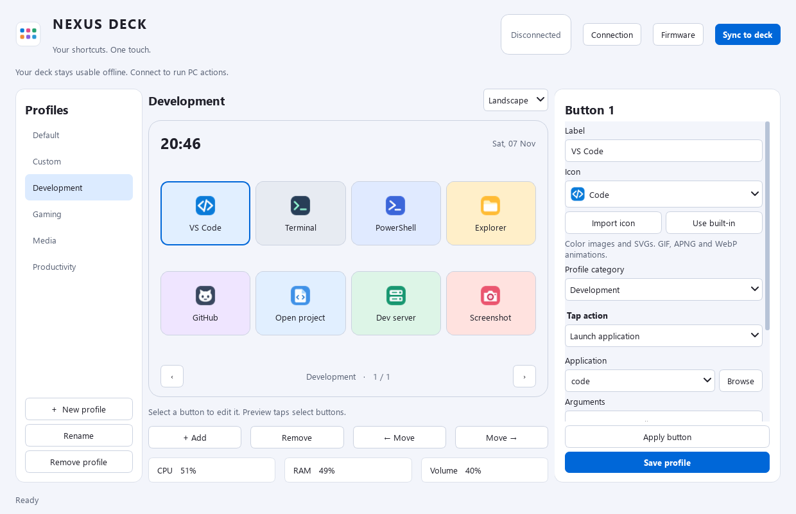

# NEXUS DECK

A wireless touchscreen macro controller for Windows 11. Launch apps, control
media, watch your PC, and switch profiles from an ESP32-S3 touch display.
A calculator, games, timers, and a pixel cat keep the deck useful offline.



<p align="center">
  <a href="docs/BUILD.md"><strong>Build &amp; install</strong></a> ·
  <a href="docs/HARDWARE.md">Hardware &amp; wiring</a> ·
  <a href="docs/APPS.md">Local apps</a> ·
  <a href="docs/OTA.md">Wireless updates</a> ·
  <a href="docs/TESTING.md">Verification</a>
</p>

<p align="center">
  <strong>ESP32-S3</strong> · ESP-IDF 5.5.4 · LVGL 9.2.2 · Windows 11 · MIT
</p>

**Current source: 1.3.1.** The repository includes the firmware, Windows
companion, default profiles, artwork, build tools, and documentation.
See [verification](#verification) for the reference device's firmware and
Bluetooth status.

## What you can do

| Feature | Included |
| :--- | :--- |
| **Your own shortcuts** | Launch applications, send keyboard shortcuts and approved text, open URLs, take screenshots, lock Windows, and show the desktop. Tap and long-press actions are configurable. |
| **Media controls** | Play/pause, next/previous track, volume buttons, mute, and a volume slider. Track information appears when Windows exposes it. |
| **Live PC stats** | CPU, RAM, disk, network upload/download, and battery. GPU usage and temperatures appear when supported; unavailable values stay unavailable. |
| **Profiles & artwork** | Default, Development, Media, Gaming, Productivity, and Custom profiles. Edit labels, icons, actions, order, and layouts on the PC, then sync over BLE. |
| **Local apps** | Calculator, 2048, Snake, countdown, focus timer, stopwatch, and a pat-able pixel cat. Large tap controls work with one stylus. |
| **Secure wireless link** | Passkey pairing, encrypted BLE, one authorized PC, framed messages, fragmentation, command replies, heartbeats, and automatic reconnection. |
| **Firmware updates** | BLE image transfer, validation, progress, cancellation, reboot verification, and boot rollback. Requires the OTA partition layout. |

PC actions run through a validated local registry. Application paths and
arguments are configured on Windows; the deck does not send arbitrary shell
commands. The UI and local apps remain available when the PC disconnects.

## On the deck

The light interface uses colorful tiles, dark readable text, and clear
navigation. Landscape is the default; portrait is available in Setup.
The idle screen switches to black with large white time, day, date, and PC name.



Firmware images are renders of the actual LVGL source with explicitly
synthetic PC and clock data. They are interface previews, not hardware
photographs. [Image sources and reproduction](assets/readme/README.md).

## More than macros



- **Calculator:** large keys, arithmetic, percentage, and a result that survives
  page changes.
- **2048 & Snake:** tap arrows, pause/new-game controls, and saved high scores.
- **Timers:** countdown presets, adjustable duration, focus sessions, and a
  stopwatch with laps. Timers continue across pages and the idle clock.
- **PC alerts:** a connected companion can play the bundled completion chime
  and show a Windows notification. Sound controls respect Windows volume/mute.
- **Pixel cat:** tap to pat, hold to open care controls, then feed, play, or nap.
  Its name, care settings, and page-following preference are saved.

See [local apps](docs/APPS.md) for controls, persistence, and offline behavior.

## Windows companion



The companion combines a live layout preview, profile manager, button editor,
Bluetooth controls, and firmware uploader. Select a tile, change its label or
action, move it, and save the profile. **Sync to deck** applies saved layouts.

Icons can be **PNG, JPEG, BMP, SVG, GIF, APNG, or WebP**. Import preserves color
and transparency, scales artwork to 32 × 32 pixels, and retains up to 16
animation frames. Artwork syncs separately from profile layout data.

Closing the editor leaves the app in the system tray. The installer can start
it automatically at Windows sign-in. Local settings and profiles live in
`%LOCALAPPDATA%\NexusDeck` and survive application updates.

The image above is a render of the actual Qt editor with local default
profiles; no deck is connected during capture.

## Hardware

| Part | Configuration |
| :--- | :--- |
| Controller | ESP32-S3; **16 MB flash** for the OTA layout |
| Display | 3.5-inch ILI9488, **16-bit 8080 parallel**, RGB565 |
| Logical layouts | 480 × 320 landscape / 320 × 480 portrait |
| Touch | XPT2046, pressure detection, five-sample median filter |
| Calibration | Three-point affine mapping, persisted in ESP-IDF NVS |
| Connectivity | Bluetooth Low Energy peripheral; Windows is the central |

The original GPIO bus, ILI9488 initialization, and optimized register writes
are preserved. The LCD uses GPIO19/20, which also serve native USB; touch uses
GPIO43/44, which also serve UART0. These shared pins affect programming and
runtime console access. Read the [wiring and power notes](docs/HARDWARE.md)
before connecting or flashing a board.

## Quick start

Install ESP-IDF **5.5.x** and its ESP32-S3 tools. The tested version is **5.5.4**;
the project pins **LVGL 9.2.2**. The Windows companion needs a BLE adapter and
64-bit Python **3.11 or later**.

### 1. Get the repository

```powershell
git clone https://github.com/Aryan-git-byte/NEXUS.git
cd NEXUS
```

### 2. Build and flash the firmware

```powershell
powershell -ExecutionPolicy Bypass -File tools\build_firmware.ps1 -Command build
powershell -ExecutionPolicy Bypass -File tools\build_firmware.ps1 -Command flash -Port COM5
```

Replace `COM5` with your board's download-mode port. The flash helper backs up
the board, checks the partition layout, and preserves compatible
calibration/settings. Use the board's BOOT/RESET procedure when required.

The helper discovers a standard `C:\Espressif` installation and accepts custom
tool paths. For the alternate compiler used during recorded verification,
see [build instructions](docs/BUILD.md).

### 3. Run the companion

```powershell
py -3.11 -m venv .venv
.\.venv\Scripts\python.exe -m pip install -r companion\requirements.txt
.\.venv\Scripts\python.exe -m companion.main
```

Use `companion/requirements-lock.txt` in place of `requirements.txt` for the
exact tested dependency environment.

### 4. Pair and customize

1. Complete the touch calibration targets on the deck.
2. Open **Setup → Pair new PC**.
3. In the Windows editor, open **Connection → Discover nearby decks**, select
   **NEXUS DECK**, then **Save and connect**.
4. Enter the six-digit passkey displayed on the deck.
5. Select a profile, edit its buttons, save, and **Sync to deck**.

The secure connection synchronizes saved profiles and starts telemetry.
Development project/server buttons use the local paths configured in the
editor's Connection dialog. [Pairing and configuration details](docs/BUILD.md).

### Optional: package and install for background use

After creating the Python environment above:

```powershell
.\.venv\Scripts\python.exe -m pip install -r companion\requirements-dev.txt
.\.venv\Scripts\python.exe -m PyInstaller companion\NexusDeck.spec --noconfirm
powershell -NoProfile -ExecutionPolicy Bypass -File tools\install_companion.ps1
```

The installer adds a Start-menu entry, an uninstaller, and sign-in startup,
then launches the app in the tray. Pass `-NoStartup` to skip automatic startup.
Use the tray's **Quit** command to stop the companion.

For portable use, copy the complete `dist\NexusDeck` folder, including
`_internal`. Python is not required on the destination PC.
[Packaging and installation details](docs/BUILD.md#package-the-companion).

## Wireless firmware updates

OTA requires a one-time USB installation of the OTA-capable partition layout
and 16 MB flash. Build the application, open **Firmware** in the Windows
editor, select `firmware/build/nexus_deck.bin` (or the application from
`build-direct`), and choose **Upload over Bluetooth**.

The companion validates the image, transfers it to the inactive slot, and
checks the rebooted firmware. Use the application binary, not a merged flash
image. See [OTA and recovery](docs/OTA.md) for transfer failures, cancellation,
rollback, and USB recovery.

## Verification

Recorded checks for source version **1.3.1**:

| Area | Recorded result |
| :--- | :--- |
| Firmware | Built with ESP-IDF 5.5.4 and LVGL 9.2.2 |
| Python suite | **220 passed in 11.15 seconds** |
| Firmware UI | **62 actual LVGL renders**, both orientations; native layout, local-app, OTA, and boot-diagnostic checks passed |
| Windows app | PyInstaller build, startup smoke check, installation, tray process, and startup registration verified |
| Reference device | Still running the verified **1.3.0** firmware |
| Current BLE/OTA observation | Intermittent disconnects remain unresolved. The 1.3.1 diagnostic OTA did not complete or select the new image. |

The failed update, subsequent reconnections, and limits of physical access are
documented in [current verification](docs/TESTING.md). No reset cause or power
rail measurement has been captured. The previously successful full 1.3.0 OTA
and reconnection checks are retained in [the 1.3.0 record](docs/TESTING_1.3.0.md).

## Repository

```text
firmware/        ESP-IDF firmware: display, touch, LVGL, BLE, storage, local apps
companion/       Windows app: editor, tray, actions, monitoring, profiles, OTA
profiles/        Six default profiles and generated device presentation bundle
assets/          Icons, fonts, sound, logo, and README images
tools/           Build, flash, install, render, and artwork generation helpers
tests/           Protocol, validation, dispatch, monitoring, editor, and OTA tests
docs/            Hardware, setup, architecture, protocol, apps, and verification
references/      Preserved original hardware code and SHA-256 manifest
```

## Documentation

| Guide | Covers |
| :--- | :--- |
| [Build & install](docs/BUILD.md) | Toolchains, packaging, pairing, startup, and configuration |
| [Hardware](docs/HARDWARE.md) | Exact pin mapping, preserved initialization, calibration, and power |
| [Architecture](docs/ARCHITECTURE.md) | Firmware tasks, LVGL, queues, and companion services |
| [Bluetooth protocol](docs/BLUETOOTH_PROTOCOL.md) | UUIDs, framing, fragmentation, validation, and security |
| [Local apps](docs/APPS.md) | Games, calculator, timers, and pixel cat controls |
| [OTA](docs/OTA.md) | Wireless uploads, partitions, rollback, and recovery |
| [Troubleshooting](docs/TROUBLESHOOTING.md) | Display, touch, Windows, BLE, and recovery issues |
| [Verification](docs/TESTING.md) | Actual build/test evidence and current hardware limits |
| [Changelog](CHANGELOG.md) | Release changes |

## License & artwork

NEXUS DECK is licensed under [MIT](LICENSE). Original project artwork and the
timer chime are included; the bundled Montserrat font retains its
[OFL license](assets/fonts/OFL.txt). See [asset attribution](assets/README.md).

The [scalable logo](assets/branding/logo.svg) and [PNG logo](assets/branding/logo.png)
are available in `assets/branding/`. README visuals can be rebuilt with
[the artwork generator](tools/generate_readme_assets.py).
