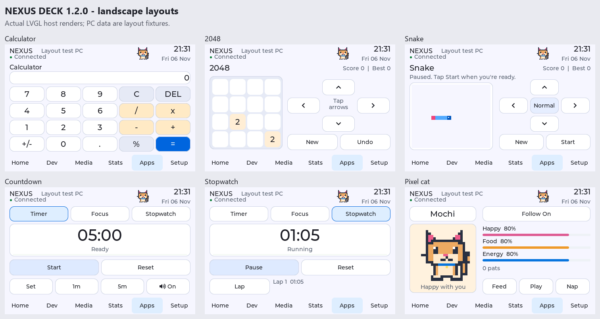
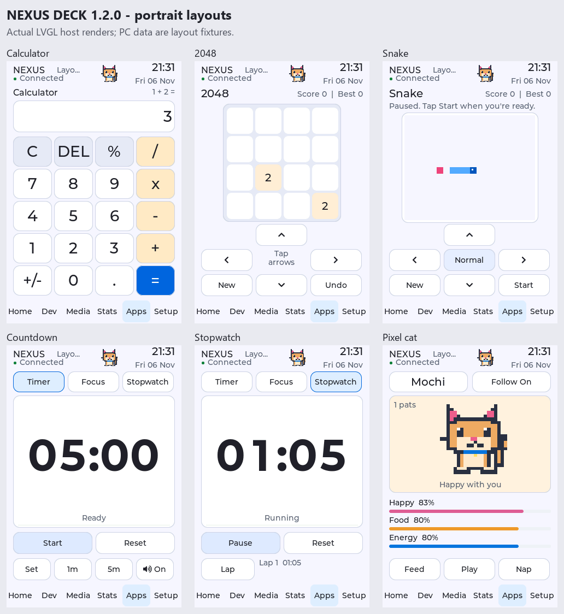

# Apps on your deck

Tap **Apps** in the bottom navigation bar. All local apps work with one stylus
and remain available without a computer connection. Tap **Macros** inside the
hub to reach your custom Windows actions.

These are actual LVGL host renders with fixture PC data. They show the layouts
before the new firmware's physical upload; they are not photographs of the board.

## Calculator

Tap the on-screen keys for arithmetic, decimals, percentages, sign changes,
backspace and repeated equals. Arithmetic is immediate, like a basic desktop
calculator: entering 1 + 2 × 3 gives 9. Percent is contextual: 200 + 10% gives
220; 200 × 10% gives 20. The display uses up to 12 significant digits and
scientific notation for small or large results. Division by zero shows a readable
error; C or a new number starts a fresh calculation.

The keypad has five rows in portrait and four rows in landscape. Its state
survives page navigation.

## 2048

Tap the four arrow buttons to slide tiles. Matching tiles merge once per move.
Each valid move adds a 2 or 4 tile. **Undo** reverses the last move once, and
**New** starts a fresh board. Reaching 2048 shows feedback and lets you continue.
High scores are saved independently of profiles. Larger tiles use K to mean
1024, so 16K is 16384.

## Snake

Tap **Start**, then use the arrow buttons to turn. Snake keeps moving in that
direction; no swipes or simultaneous presses are needed. Tap the center
**Slow / Normal / Fast** button to change speed. **Pause** holds the game, and
**New** starts again. Leaving the page pauses Snake and retains its board.

Eat the pink food, avoid the walls and your body, and fill the board to win.
Reverse turns and a second queued turn before the next step are ignored.

## Timers

- **Timer:** choose Set and adjust Hours, Minutes and Seconds. Holding a plus or
  minus repeats the adjustment. Set timer applies it. The range is one second
  through 24 hours; 1m and 5m are quick presets.
- **Focus:** automatic 25-minute work and 5-minute break sessions. Every fourth
  work session is followed by a 15-minute break.
- **Stopwatch:** counts elapsed time and records the latest lap. Pause/Resume
  preserves elapsed time; Reset clears it.

Pause before changing mode or duration. Countdown/focus timers and the stopwatch
continue across pages and through the screensaver. A countdown completing during
sleep wakes the timer page. Active timers reset after device power loss or a
restart; the chosen mode and countdown preset are saved.

The speaker **On / Off** button controls whether the deck requests a PC chime.
In the Windows editor, open **Connection > Timer sound** to enable/disable
completion sounds or **Test chime** to hear the bundled tone. Windows master
volume and mute also apply. Tray notifications remain available when completion
sounds are disabled or an audio device is unavailable.

Only the connected, authorized companion receives completion events. Offline
events show local feedback and are not played later on reconnect.

## Your pixel cat

The cat lives in the header. Tap it to pat; hold it to open its page. You can
also tap Pixel cat in Apps. A pat produces a heart and a purr expression.

**Feed** restores food, **Play** boosts happiness while using some energy, and
**Nap / Wake** toggles sleep. Happiness and food decrease slowly; naps restore
energy. Your cat never disappears because of low care values.

Tap the name to cycle through Mochi, Nori, Pixel and Coco. **Follow On / Off**
shows/hides the header cat. It becomes a small white sleeping cat on the black
clock screen and stays clear of clock lettering. Calibration and modal controls
temporarily hide it.

Care values, name, pat count, visibility, game high scores and app preferences
are stored in a separate NVS record. Writes are coalesced for responsiveness.
Care recovery after restart uses synchronized PC time when available and caps
offline decay at 24 hours.
