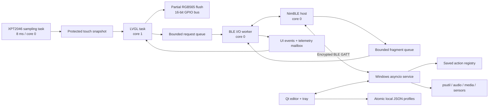

# NEXUS DECK architecture

NEXUS DECK is an ESP32-S3 BLE peripheral and a Windows BLE central. The deck owns
its display, calibration, navigation, saved layouts, and connection feedback. The
companion owns executable actions, telemetry, and the editable source profiles.

## Firmware ownership

`display/lcd_driver.cpp` is the only LCD bus owner. The original register-write
lookup tables, WR strobes, initialization data, MADCTL `0x48`, and RGB565 COLMOD
`0x55` are retained. One 23,040-byte internal RAM buffer feeds LVGL's partial
renderer. Landscape transposes each flushed rectangle into the unchanged native
panel address space during transfer. No full-frame rotation buffer is required.

`display/touch_driver.cpp` exclusively owns the XPT2046 GPIOs. Sampling runs every
8 ms independently of LVGL. The UI reads a protected snapshot; it never performs
bit-banged SPI inside an LVGL input callback. The reference pressure formula,
commands, five-sample median, affine transform, and `touch/cal` NVS format remain.
Calibration is a UI state machine with a settling period, 30 distinct samples per
target, stability checks, release gating, and determinant/scale validation.

Only the UI task calls LVGL after initialization. BLE callbacks copy ATT packets
into a 12-entry queue. The I/O worker reassembles, validates, and processes JSON.
Telemetry uses a one-entry overwrite mailbox, so a slow display never accumulates
stale telemetry. Action requests and replies use bounded queues. A profile update
transfers ownership of one validated `ProfileSet` to the UI. Button arrays are
allocated once per configured profile, then released when its replacement arrives.

Settings and profiles are written by the I/O worker. Affine calibration is saved
once at the end of the calibration interaction. NVS handles are closed on every
path. A first boot loads compiled presentation profiles; subsequent boots load
the saved layouts without needing a PC connection.

## Windows ownership

Qt owns the GUI thread. `Controller` runs an asyncio service on a separate thread
and exchanges queued Qt signals. BLE discovery, reconnects, writes, replies, and
profile acknowledgements run there. psutil/audio monitoring and actions run in
worker threads. COM audio objects are created and released on their calling
thread, never shared across Qt or asyncio threads.

The editor works on a draft. Saving validates it and replaces a JSON file
atomically. Sync sends only presentation fields to the deck. The executable
registry switches to the saved snapshot only after the device acknowledges
validation and persistence. BLE messages cannot supply application paths,
arguments, text snippets, URLs, or a new action definition.

## Failure behavior

* A missing PC gives immediate local button feedback. Offline actions are not
  queued for later execution.
* A disconnect clears the authenticated application session and pending actions;
  navigation, calibration, profile selection, and the clock keep working.
* Sensor failures yield `null`. Device labels show `--`, with empty indicators.
* Live metrics become stale after 6.5 seconds. A 15-second application heartbeat
  timeout closes a stalled link; valid in-progress fragments count as activity.
* Windows reconnects with bounded backoff and syncs saved profiles again.
* Action replies are cached for the latest 64 action sequences. Older sequences
  are rejected, preventing an expired retry from executing again.
* Exactly-once execution across a companion process crash is not promised: a
  reconnect creates a new session, and the deck discards old pending actions.

No Wi-Fi, cloud service, Bluetooth Classic, external display library, or PC
process is required to render and operate the device UI.
