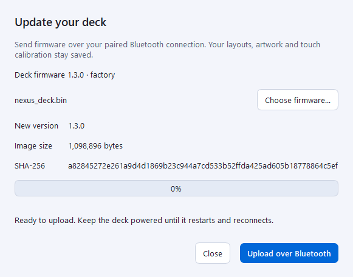

# Wireless firmware updates

NEXUS DECK 1.3.0 can receive application firmware over its existing encrypted
Bluetooth LE connection. No Wi-Fi credentials, access point or extra pins are
needed. The normal Windows companion stays installed in the tray.

## First installation

The older 1.2.0 firmware has no update receiver or OTA slots. Install 1.3.0
over USB once with `tools/build_firmware.ps1 -Command flash -Port COM17` (use
your actual port). The helper backs up the device, checks the partition layout
and preserves calibration, pairing, preferences, profiles and artwork. Hold
BOOT, tap RESET, then release BOOT if native USB is absent during normal operation.

The new layout requires 16 MB flash and the rollback-enabled ESP-IDF bootloader.
The factory image remains at `0x60000`; the two 4 MB update slots are at
`0x660000` and `0xA60000`. Boot metadata occupies the unused `0x5A000` gap.

After a USB bootstrap, tap RESET without holding BOOT to return to the dashboard.
Install the current 1.3.0 companion: it can recover Windows' earlier cached GATT
table while preserving the saved bond. Subsequent firmware boots announce
Service Changed to refresh that table automatically. Wireless upload runs from
the dashboard/UI, never from ROM download mode.

This preview uses the actual Windows dialog with a fixture connection state;
the file version, size and digest come from the compiled application.

## Upload the next build

1. Compile the firmware using the normal build helper.
2. Power the deck and let the installed companion connect and sync profiles.
3. Open the editor from the tray and click **Firmware**.
4. Choose `firmware/build/nexus_deck.bin`, or the application file in the
   `build-direct` directory used by your build command. Review its version,
   byte count and SHA-256, then click **Upload over Bluetooth**.
5. Keep the deck powered while it uploads, checks the image, restarts and
   reconnects. Completion means the new image's slot, version, ELF identity
   and boot confirmation have been checked over a fresh Bluetooth session.

Choose only a NEXUS DECK application built with this OTA/boot-validation code.
Bootloader, partition-table, merged flash images, wrong-chip files and damaged
images are rejected by the companion. The complete application must fit 4 MB.
The Firmware window disables upload for disconnected/legacy devices and while
a new image is still being checked after boot.

The negotiated Bluetooth MTU controls packet size. Updates also work with the
minimum MTU, but are substantially slower. Normal telemetry and actions retain
their own queues; profile synchronization waits until transfer completion.
The deck shows update progress without changing its display/touch drivers.

## Cancel, disconnect and power loss

**Cancel upload** discards an uncommitted transfer. A new attempt starts from
byte zero. Lost acknowledgements retry the same chunk without writing it twice.
A disconnect or 120-second transfer inactivity aborts the writer. The existing
boot image remains selected until full SHA-256 and ESP-IDF validation succeed.

Once verification commits the image, Cancel is disabled and the deck restarts.
The new image requires 20 continuous seconds of live UI and synchronized
Bluetooth host health to confirm its boot. This does not require the PC to
remain connected. An unhealthy pending image restarts after 45 seconds so the
bootloader can choose the previous usable image. Unexpected resets before
confirmation also trigger bootloader rollback. An unverified reconnect is
reported as a failure, even if the upload itself finished.

The file hash detects corruption; authenticated pairing restricts uploads to
the saved PC. This is not a cloud updater or a secure-boot signature service.
Select firmware you built or trust on that PC.

## USB recovery

Enter ROM download mode with BOOT/RESET and flash using the same helper.
It backs up the current partitioned flash and initializes only OTA boot metadata
to select the newly written factory application. Saved NVS/artwork stays at its
existing offsets. The two wireless slots are not erased by recovery. Do not use
`erase_flash` or Factory reset to repair a transfer if you need to retain data.

## Source and verification

Firmware: `firmware/main/update/ota_manager.cpp`. Windows validation/transfer:
`companion/firmware.py`, `companion/bluetooth.py`; native UI:
`companion/firmware_dialog.py`. UUIDs and message fields are documented in
[BLUETOOTH_PROTOCOL.md](BLUETOOTH_PROTOCOL.md). Actual build, software and device
test evidence is recorded in [TESTING.md](TESTING.md).
